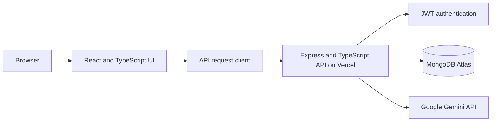

# Book Reservation System — Frontend

[](https://github.com/hosakiya/itelect4-project-it4b-gt1/actions/workflows/ci.yml)

React and TypeScript frontend for the DLSL Book Reservation & Academic Catalog System. It supports authentication, catalog search, reservations, a student dashboard, and protected AI reviews.

## Live deployments

- **Frontend:** [https://itelect4-project-it4b-gt1.vercel.app/](https://itelect4-project-it4b-gt1.vercel.app/)
- **Backend API:** [https://itelect4-backend-eosin.vercel.app/](https://itelect4-backend-eosin.vercel.app/)
- **Backend health check:** [https://itelect4-backend-eosin.vercel.app/api/health](https://itelect4-backend-eosin.vercel.app/api/health)

## Architecture



## Run locally

Use PowerShell from the frontend repository folder. The backend repository should be next to this folder, as in the supplied project layout.

1. Install root and frontend dependencies:

   ```powershell
   npm ci
   npm ci --prefix GT2P3
   ```

2. In the sibling `it-elect-backend` folder, install backend dependencies and prepare its local environment:

   ```powershell
   cd ..\it-elect-backend
   npm ci
   Copy-Item .env.example .env
   ```

   Fill in `MONGODB_URI` and `JWT_SECRET`. Set `CORS_ORIGIN` to `http://localhost:5173`; add `GEMINI_API_KEY` to enable AI reviews. `MONGODB_DNS_SERVERS` is optional.

3. Return to the frontend repository folder and set up the Vite environment:

   ```powershell
   cd ..\ITELECTGT1P1
   Copy-Item GT2P3/.env.example GT2P3/.env
   ```

   Set `VITE_API_URL=http://localhost:4000` in `GT2P3/.env`.

4. Start the frontend and backend together with `npm run dev`.
5. Run the frontend tests with `npm test` and the production build check with `npm run build`.

## Environment variable

`VITE_API_URL` is the backend base URL, without `/api` or a trailing slash. The Vercel frontend project uses the backend deployment URL shown above. `.env.example` files document local configuration; do not commit `.env` files.

## AI-use disclosure

OpenAI Codex (an AI coding assistant) was used to help write the frontend component, hook, and form tests; backend route tests; Vitest and CI configuration; environment examples; and project documentation. The author ran the local tests and build checks.

## Author

Mikaela Ysabel L. Lantafe | IT4B
